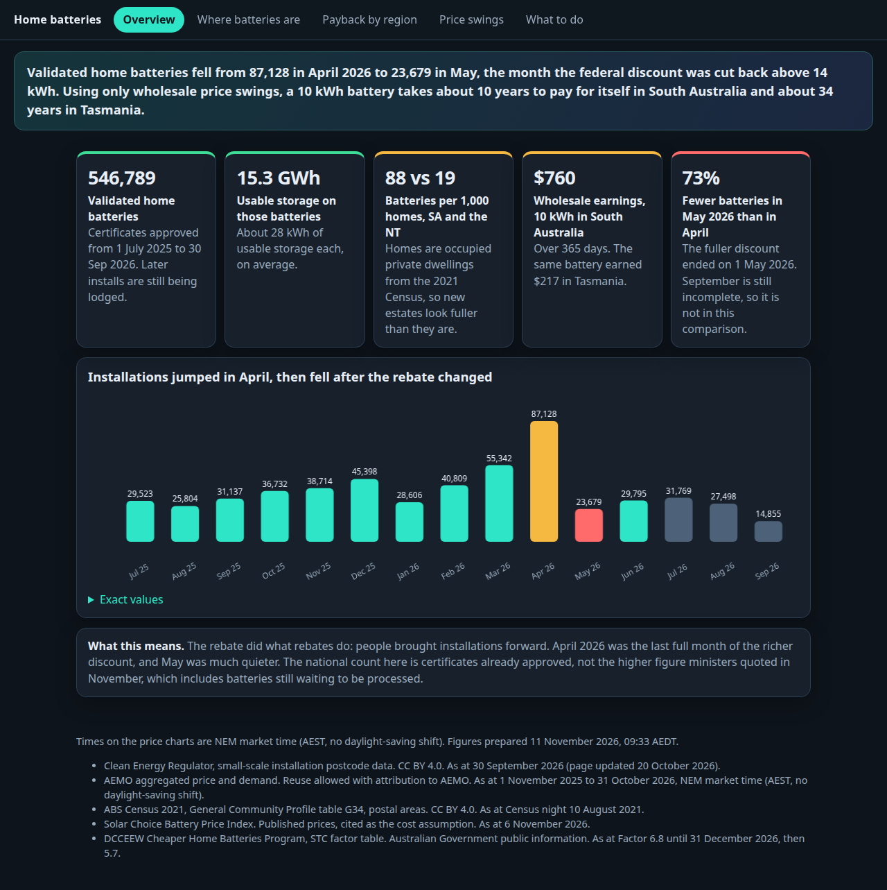
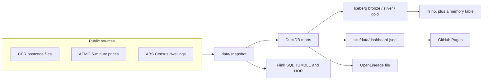

# Where a home battery pays back

[](https://github.com/LuciferDataEngineer/home-battery-payback/actions/workflows/ci.yml)
[](https://luciferdataengineer.github.io/home-battery-payback/)
[](LICENSE)
[](pyproject.toml)
[](src/hbp/flink_job.py)
[](src/hbp/iceberg_store.py)
[](docker-compose.yml)
[](src/hbp/analytics.py)

**Live dashboard:** https://luciferdataengineer.github.io/home-battery-payback/

Australia's Cheaper Home Batteries Program (from 1 July 2025, run by the Clean Energy Regulator) has put hundreds of thousands of batteries on houses. From 1 May 2026 the full discount applies only to the first 14 kWh. Treasury is drafting further cuts. This project answers three questions with public data:

- Where are the batteries, relative to homes and to rooftop solar?
- Which regions are thin on batteries?
- Where do real wholesale price swings pay a battery back, and what does the next scheduled cut do to those years?



The quantified write-up is [INSIGHTS.md](INSIGHTS.md). The short version, from the snapshot dated 10 November 2026:

- **546,789** validated batteries and **15.3 GWh** to 30 September 2026. About **28 kWh** each. The November "600,000 batteries" line includes later and pending systems that are not in this file.
- Installations fell from **87,128 in April 2026 to 23,679 in May**, when the richer discount ended.
- **87.5 batteries per 1,000 homes in South Australia**, against **19.3 in the Northern Territory** and **26.0 in Tasmania**. Homes are the 2021 Census.
- A 10 kWh battery earning only from wholesale swings takes **9.7 years** in South Australia and **34 years** in Tasmania. The January 2027 certificate cut adds about **0.6 years** in South Australia and about **2 years** in Tasmania.

## Architecture



CI never downloads. `make ingest` does. The Kubernetes job and the unit tests read the snapshot.

## Stack

| Piece | Why it is here |
| --- | --- |
| PyFlink 2.1 Table SQL | Event-time `TUMBLE` and `HOP`, watermarks, and an allowed-lateness test on late prices. File source in CI. Redpanda is in the compose profile for a full replay. |
| Apache Iceberg | Bronze, silver and gold. Month and identity hidden partitions. A column added after the first snapshot. Time travel to the drilled row and back. |
| PyIceberg SQL catalog | The CI lakehouse. No JVM required for the numbers. |
| Iceberg REST + MinIO + Trino | The compose stack. Trino deletes with `write.delete.mode=merge-on-read` and joins Iceberg to a memory table. |
| DuckDB | The mart. Fastest of the in-process engines, and it writes the dashboard JSON. |
| Dagster | Assets and asset checks from snapshot to dashboard. In-process `materialize`, no daemon. |
| OpenLineage | A file of run events in CI, and a graph snapshot in `lineage/graph.json`. Marquez is a compose profile. |
| Pandera + YAML contracts | Failing rows are split out. The full price file is also checked in SQL. |
| kind | The batch image runs as a Kubernetes Job and prints the gold battery count. |
| GitHub Actions + Pages | Lint, snapshot pipeline, Flink, kind, compose, browser. Pages deploys `site/`. |

Postgres is not used. DuckDB is the database. Nothing here needs an account, a key, or a paid API.

## What's new versus the previous project

[aged-care-bed-block](https://github.com/LuciferDataEngineer/aged-care-bed-block) landed rows in Postgres 16, tailed them with Debezium Server into Redpanda, and folded them with PySpark Structured Streaming into a Delta Lake table using `MERGE` and SCD2. Contracts were YAML, checks ended in DuckDB, lineage was OpenLineage, and Terraform validated the shape of the platform.

This project keeps the contract and lineage habit and changes the storage and the clock:

| | #11 aged-care-bed-block | #12 this repo |
| --- | --- | --- |
| Change capture | Debezium Server out of Postgres | Not a database log. CER revisions are row updates on an Iceberg snapshot. |
| Bus | Redpanda, required | Redpanda is an optional compose profile. CI replays a file. |
| Stream engine | PySpark Structured Streaming | PyFlink Table SQL, event time, watermarks, allowed lateness |
| Table format | Delta Lake MERGE + SCD2 | Iceberg. Hidden partitions, schema evolution, snapshot ids, merge-on-read in Trino, copy-on-write fallback in PyIceberg |
| Query | Spark and DuckDB | Trino federation plus DuckDB |
| Orchestration | A scripted batch | Dagster assets and asset checks |
| Cluster check | Terraform validate | kind Job running the gold aggregation |

## Data

| Publisher | What | URL | Licence | Coverage | Accessed |
| --- | --- | --- | --- | --- | --- |
| Clean Energy Regulator | Battery counts, usable kWh, solar counts by postcode | [Postcode data](https://cer.gov.au/markets/reports-and-data/small-scale-installation-postcode-data) | CC BY 4.0 | Batteries from July 2025, file current as at 30 September 2026 | 10 Nov 2026 |
| AEMO | 5-minute regional price and demand | `PRICE_AND_DEMAND_YYYYMM_REGION.csv` under [aemo.com.au](https://aemo.com.au/aemo/data/nem/priceanddemand/) | Reuse allowed if AEMO is attributed. [Copyright permissions](https://www.aemo.com.au/privacy-and-legal-notices/copyright-permissions) | NSW1, QLD1, VIC1, SA1, TAS1, Nov 2025 to Oct 2026 | 10 Nov 2026 |
| Australian Bureau of Statistics | Occupied private dwellings by postal area | [2021 GCP POA datapack](https://www.abs.gov.au/census/find-census-data/datapacks/download/2021_GCP_POA_for_AUS_short-header.zip), table G34 `Total_dwelings` | CC BY 4.0 | Census night 10 August 2021 | 10 Nov 2026 |
| Solar Choice | Installed price after the rebate | [Battery Price Index](https://www.solarchoice.net.au/solar-batteries/price/) | Their published index, used as a cost assumption | 6 November 2026 | 10 Nov 2026 |
| DCCEEW | STC factor by date and size band | [Cheaper Home Batteries](https://www.dcceew.gov.au/energy/programs/cheaper-home-batteries) | Australian Government public information | Factor 6.8 to 31 Dec 2026, then 5.7 | 10 Nov 2026 |
| Natural Earth | State outlines on the map | 1:50m admin-1, public domain | Public domain | Simplified, Jervis Bay drawn with NSW | 10 Nov 2026 |

All of it is free. Hashes, row counts and the exact URLs are in [`data/snapshot/MANIFEST.json`](data/snapshot/MANIFEST.json). The snapshot is about 5 MB.

## Cleaning

- Postcodes are forced to four digits. `POA2000` becomes `2000`. Postcode `0000` is dropped.
- State comes from Australia Post ranges, because the CER file has no state column. The national total matches the regulator's state table (546,789). State totals differ by fewer than 150 systems where a postcode crosses a border.
- Capacity figures contain thousands-separators. They are stripped.
- AEMO interval timestamps are the end of the five minutes, in NEM time, which stays on AEST all year. The trading day is the date of the interval start, so the midnight interval belongs to the previous day. Days with a full set of intervals are kept: 365 days, five regions.
- Price rows outside −$1,000 to $25,000/MWh, or demand outside −5,000 to 20,000 MW, would be quarantined. This snapshot has none. A unit test injects a bad price and a bad region and checks they are split out.
- Dwellings are the G34 total, which is the occupied-private-dwelling count for that table (9,275,066 across 2,643 postal areas).

## Model

| Table | Grain | Key |
| --- | --- | --- |
| `bronze.battery_month` | One postcode, one month, as published | postcode, install_month |
| `silver.battery_month` | Same, plus a revision note added after the first snapshot | postcode, install_month |
| `gold.payback` | One NEM region, one battery size, one subsidy scenario | region, usable_kwh, scenario |
| DuckDB daily spread | One region, one day | region, nem_date |
| Dashboard JSON | One document | — |

Prices stay in the Parquet snapshot (and in the Flink job). Copying half a million intervals into a second lakehouse file does not change the answer. The lakehouse holds the battery months, which are the rows the regulator revises.

The charge window is the cheapest 24 consecutive intervals (two hours) ending between 12:00 and 15:00. The discharge window ends between 18:00 and 21:00. Value for one cycle is `kWh/1000 * (discharge price − charge price / 0.90)`, and a negative day is counted as zero. Payback is the after-rebate price divided by the sum of those days.

## Stream

Prices are event-time records. The watermark is `max event timestamp − allowed lateness`, emitted on every record so a test does not depend on a processing-time timer. SQL `TUMBLE` of 10 minutes and `HOP` of 2 hours sliding 30 minutes run in the Java engine.

The test stream, in arrival order, is: a price at 00:00, a price at 00:10, a price at 00:06, a price at 00:15, and a price at 00:01. With 5 minutes of allowed lateness the 00:06 row is counted in the first window and the 00:01 row is not. A second test checks each hop average against the rows that fall inside it. A third test runs one real South Australian day (15 January 2026) and matches the minimum, maximum and negative-price count.

PyFlink's own Python window operator does not see those watermarks (its clock stays at the minimum long). The windows under test are the SQL engine's.

## Iceberg

- `silver.battery_month` is partitioned by `month(install_month)`. `gold.payback` is partitioned by `scenario`. Callers do not write a partition column.
- After the first append, `revision_note` is added. Older snapshots do not have it.
- Postcode **2765**, September 2026, is 112 installs in the file. The drill writes 113, then deletes that row and writes 112 again. Snapshot ids are in [`docs/iceberg-snapshots.json`](docs/iceberg-snapshots.json). The current snapshot matches the file. The dashboard does not read the drilled one.
- Table properties ask for merge-on-read. PyIceberg 0.12 warns and rewrites the month file (copy-on-write). The first delete in the drill is an `OVERWRITE` of that month. Trino, in compose, honours merge-on-read. See [BENCHMARK.md](BENCHMARK.md).

## Quality and lineage

Asset checks fail the Dagster run if the five regions are missing, if South Australia does not pay back faster than Tasmania, if the national count is not 546,789, or if the banner does not mention May. YAML contracts live in `data/contracts/` and name the same columns as the Pandera schemas.

OpenLineage events go to `lineage/events.jsonl`. `lineage/graph.json` is the edge list. Marquez is `docker compose --profile lineage up`.

## Benchmark

DuckDB groups the year of prices in about 50 ms. PyArrow takes about 170 ms. Flink's mini cluster spends about 7 seconds starting up to tumble one day. Rewriting a file is roughly ten times the write of a delete-key file, and about 200 times the bytes. Detail, and the $0 note, are in [BENCHMARK.md](BENCHMARK.md).

## Run it

```bash
python -m pip install -e ".[dev]"
make test          # unit tests, no Java, no browser
make pipeline      # snapshot -> Dagster -> Iceberg -> lineage -> dashboard JSON
```

Flink, on Python 3.11 with Java 17:

```bash
pip install "apache-flink==2.1.1"
JAVA_HOME=/usr/lib/jvm/java-17-openjdk-amd64 PYTHONPATH=src pytest -m flink
```

Refresh the snapshot from the live files (needs the network, not used in CI):

```bash
make ingest
```

The lakehouse and a federated query:

```bash
docker compose up -d minio iceberg-rest trino
sh scripts/trino_smoke.sh
```

Optional profiles: `--profile stream` for Redpanda, `--profile lineage` for Marquez.

The static site is `site/`. From that directory, `python -m http.server` and open the printed URL. GitHub Pages serves the same tree.

## Tests and CI

| Job | What it proves |
| --- | --- |
| lint and unit tests | Ruff, Pandera quarantine, certificate arithmetic, the 546,789 total, the May drop, the payback ranking |
| pipeline from snapshot | Dagster, Iceberg snapshots, lineage file, dashboard JSON |
| Flink | Late row kept, older row dropped, hop averages, one real day |
| kind | The batch image, as a Job, prints `GOLD_BATTERIES=546789` and a South Australian spread above Tasmania |
| compose | Trino creates an Iceberg table, deletes a row merge-on-read, joins a memory table |
| browser | Every tab renders, canvases have width, the January 2027 filter changes the title, no console errors |
| Pages | On `main`, upload `site/` and deploy |

No job is marked `continue-on-error`.

## Limits, and what is next

- Wholesale swings are not a household bill. Self-consumption of rooftop solar is the missing half of the payback, and it needs a tariff, not just the regional price.
- The December budget options are not published. The cut in the dashboard is the factor already written into the regulations for January 2027.
- Census dwellings are from 2021. A postcode built since then will look fuller of batteries than it is.
- PyIceberg cannot yet write equality deletes. The merge-on-read path is the Trino job.
- A full Flink cluster reading Redpanda is sketched, not required, because the file replay already carries the timestamps.

## Licence

Code is MIT, see [LICENSE](LICENSE). Data stays under the publisher licences in the table above. Attribute the Clean Energy Regulator, the ABS, and AEMO when you reuse the snapshot.
